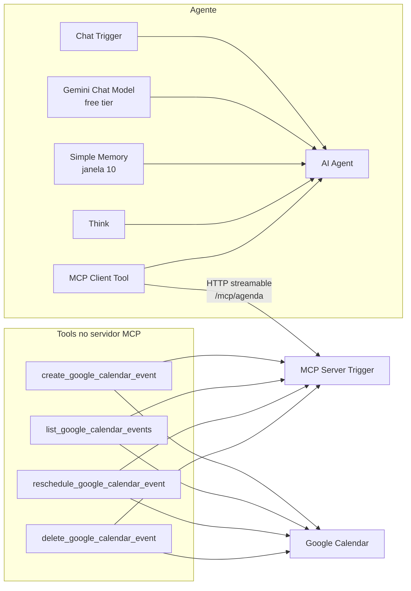

# Agente de agenda com n8n, MCP nativo e Google Calendar

Exemplo **100% gratuito** de um agente que cria, lista, reagenda e cancela eventos no Google Calendar. O fluxo segue a aula 16 do curso da Rocketseat *Introdução a automação com n8n* e troca o modelo pago (GPT-4.1 mini) por um LLM sem custo.

O padrão é o **Google Gemini** no free tier (nó Google Gemini Chat Model, chave criada no Google AI Studio). A alternativa é o **Ollama** rodando na sua máquina. O n8n sobe localmente com Docker Compose, também sem custo para uso pessoal.

Nada neste repositório contém chave de API, client secret ou token. Os workflows só trazem placeholders.

## Arquitetura

O chat entra num AI Agent. O agente raciocina com a tool Think, lembra as últimas 10 interações e chama um MCP Client. Esse client fala com o MCP Server Trigger **do mesmo workflow**, que expõe quatro tools do Google Calendar.

Na aula, o campo do client se chamava *SSE Endpoint*. No n8n 2.44+ o MCP Server Trigger **versão 2** usa HTTP streamable e a URL de produção **não** termina com `/sse`. O client deste exemplo está na versão 1.4, com transporte `httpStreamable`. A versão 1.1 do trigger quebra parâmetros com expressão (`$fromAI`) e devolve `No bridge acquired for this context`.



Para a alternativa local, o nó Gemini sai e entra o Ollama Chat Model. O path do MCP passa a ser `agenda-ollama`, para os dois workflows poderem coexistir.

## O que tem no repositório

| Arquivo | Função |
|---|---|
| `workflows/agente-agenda-mcp.json` | Workflow principal: Chat Trigger, AI Agent, Gemini, memória, Think, MCP Client e MCP Server com as 4 tools |
| `workflows/agente-agenda-mcp-ollama.json` | O mesmo fluxo com Ollama no lugar do Gemini |
| `docker-compose.yml` | n8n estável. Ollama fica no profile `ollama` |
| `.env.example` | Fuso, URL de webhook e chave de criptografia. Sem segredo real |
| `scripts/validar-workflow.mjs` | Checagem estrutural dos dois JSON |

## Custo zero

- **n8n** self-hosted, imagem `n8nio/n8n:2.44.6` (canal stable em 23/10/2026). Uso pessoal e interno é gratuito sob a [Sustainable Use License](https://docs.n8n.io/sustainable-use-license/). O beta `2.45.3` publica os mesmos typeVersions usados aqui.
- **Gemini**: modelo `models/gemini-3.5-flash-lite`. Na tabela do Google em 23/10/2026, entrada e saída desse modelo são *Free of charge* no free tier. Não clique em *Set up billing* no AI Studio. No free tier o Google pode usar o conteúdo para melhorar os produtos deles.
- **Google Calendar**: a API de calendário não é cobrada. Crie o projeto no Google Cloud **sem** conta de faturamento.
- **Ollama**: software local e modelos abertos. O custo é CPU/RAM da sua máquina, não uma assinatura.

Não publique o app OAuth nem ative billing “para destravar”. Os dois passos abaixo funcionam de graça, com os limites descritos em cada seção.

## Pré-requisitos

- Docker e Docker Compose
- Uma conta Google (Gmail) para o calendário e para o AI Studio
- Nada de cartão de crédito

## 1. Subir o n8n

Na raiz do repositório:

```bash
cp .env.example .env
openssl rand -hex 32
```

Cole a saída no `N8N_ENCRYPTION_KEY` do `.env` **antes** do primeiro start. Se você criar credenciais e só depois trocar a chave, o n8n não consegue mais lê-las.

```bash
docker compose up -d
```

Abra [http://localhost:5678](http://localhost:5678) e crie o usuário dono da instância. A porta está presa a `127.0.0.1`. O servidor MCP deste exemplo não tem autenticação; não exponha a porta na rede.

O fuso do container e do workflow é `America/Sao_Paulo`. Isso entra no `$now` junto com o `.setZone(...)` do system message.

## 2. Chave do Gemini

1. Entre em [Google AI Studio → API keys](https://aistudio.google.com/apikey).
2. Crie uma chave num projeto **sem** faturamento. Se o projeto já tem billing, as chamadas podem sair do free tier.
3. No n8n: *Credentials → Add credential → Google Gemini(PaLM) Api*.
4. Cole a chave e salve. O host padrão da credencial (`https://generativelanguage.googleapis.com`) está certo.
5. Não commite a chave. O `.env.example` só reserva o nome `GEMINI_API_KEY` como lembrete; o container não lê essa variável.

Se o dropdown do nó não listar `models/gemini-3.5-flash-lite`, escolha outro modelo Gemini 3.x que a [tabela de preços](https://ai.google.dev/gemini-api/docs/pricing) marque como gratuito e mantenha o prefixo `models/`. Não use um modelo só do tier pago.

## 3. Google Calendar (OAuth, sem custo)

O nó pede uma credencial **Google Calendar OAuth2 API**. O client OAuth é criado num projeto Cloud gratuito.

1. Abra o [Google Cloud Console](https://console.cloud.google.com/) e crie um projeto. Se pedir conta de faturamento, pule: Calendar API e tela de consentimento OAuth não exigem billing.
2. *APIs e serviços → Biblioteca* → ative **Google Calendar API**.
3. *APIs e serviços → Tela de consentimento OAuth*. Tipo **Externo**, status **Em teste**. Adicione o seu Gmail como usuário de teste. Escopo usado pelo n8n: `https://www.googleapis.com/auth/calendar`.
4. *APIs e serviços → Credenciais → Criar credenciais → ID do cliente OAuth → Aplicativo da Web*.
5. Em *URIs de redirecionamento autorizados* cole a URL que o n8n mostra na credencial. No Compose deste repo é:

   `http://localhost:5678/rest/oauth2-callback`

6. Copie o Client ID e o Client Secret para a credencial *Google Calendar OAuth2 API* no n8n e clique em *Sign in with Google*. Entre com o mesmo Gmail que está na lista de usuários de teste.

App em modo teste: o refresh token expira em cerca de **7 dias**. Quando o calendário parar de autorizar, abra a credencial e conecte de novo. Publicar o app para produção pode exigir verificação do Google por causa do escopo sensível; para estudar, reconectar continua de graça.

## 4. Importar, ligar credenciais e publicar

1. No n8n: *Create workflow → ⋯ → Import from file* e escolha `workflows/agente-agenda-mcp.json`.
2. Abra o nó **Google Gemini Chat Model** e selecione a credencial que você criou. O modelo já vem `models/gemini-3.5-flash-lite`.
3. Nos quatro nós de calendário (`create_`, `list_`, `reschedule_`, `delete_`):
   - selecione a credencial OAuth;
   - troque `COLOQUE_SEU_EMAIL@gmail.com` pelo seu Gmail (ID do calendário principal) **ou** mude o campo Calendar para *From list* e escolha o calendário.
4. Abra o **MCP Server Trigger**. A URL de produção deve ser `http://localhost:5678/mcp/agenda`.
5. Confira o **MCP Client**: *Endpoint* = essa mesma URL, transporte **HTTP Streamable**, autenticação **None**. O client roda dentro do container, então `localhost:5678` é o próprio n8n. Não troque por um IP da rede local.
6. Salve e **publique** o workflow (botão *Publish* / *Active* no canto superior). Sem publicar, a URL de produção do MCP responde erro — é o primeiro item da tabela da aula.

O Chat Trigger fica privado (`public: false`). A conversa é o chat embutido do editor, o mesmo *Chat Message* da aula. O prompt do agente é `{{ $json.chatInput }}`.

System message, copiado da aula:

```text
Você é um agente responsável por manipular o Google Calendário. Você está conectado à um servidor MCP.
Sempre antes de utilizar as ferramentas de criar, reagendar ou cancelar eventos, utilize a ferramenta de listagem de eventos para verificar a disponibilidade do horário solicitado.
---
Data atual: {{ $now.setZone('America/Sao_Paulo') }}
```

As quatro tools usam *Tool Description → Set Manually*, com o texto resumido da aula, e os parâmetros dinâmicos passam por `$fromAI`, com exemplo ISO `-03:00`.

| Tool | Operação n8n | O que o modelo preenche |
|---|---|---|
| `create_google_calendar_event` | Create | `start`, `end` (fim = início + 30 min), `summary`, `description`, `attendee` |
| `list_google_calendar_events` | Get Many, Return All | `start` (After), `end` (Before) e, se houver, `attendee_email` |
| `reschedule_google_calendar_event` | Update | `event_id`, `new_start`, `new_end` |
| `delete_google_calendar_event` | Delete | `event_id`, depois de pedir o e-mail de quem pediu |

Criar, reagendar e cancelar já saem com `sendUpdates: all`, então o convidado recebe o aviso. Google Meet é opcional e fica desligado. Para ligar, no nó de criar evento: *Additional Fields → Conference Data → Conference Solution* = `hangoutsMeet`.

Não ative os dois workflows ao mesmo tempo se você editar os dois para o mesmo path. Os paths padrão (`agenda` e `agenda-ollama`) não colidem.

## 5. Prompts para testar no chat

Abra o workflow publicado e use o painel de chat.

- `Quais compromissos eu tenho amanhã?`
- `Marca uma reunião de 30 minutos amanhã às 14h com ana@exemplo.com. Título: proposta comercial. Descrição: alinhar escopo.`
- `Esse horário está livre na sexta de manhã?`
- `Reagenda a reunião com ana@exemplo.com de amanhã às 14h para sexta às 10h.`
- `Cancela a reunião com ana@exemplo.com de amanhã às 14h.`

O agente deve listar a agenda antes de criar, reagendar ou cancelar. No cancelamento ele pede o e-mail se você não tiver dito. Use um e-mail que você controle na primeira criação, para ver o convite chegar.

## Alternativa Ollama (local)

O Gemini continua sendo o padrão. Ollama entra quando você não quer mandar o prompt para fora da máquina. Modelos pequenos erram tool calling com mais frequência; se o agente responder sem chamar as tools, troque o modelo.

```bash
docker compose --profile ollama up -d
docker compose exec ollama ollama pull llama3.2
```

`llama3.2` é o default do nó e cabe em máquinas modestas (cerca de 2 GB). Para tool calling melhor, `ollama pull qwen2.5:7b` e altere o campo *Model* — isso pede mais RAM.

No n8n, credencial **Ollama** com base URL:

- Compose: `http://ollama:11434` (o n8n enxerga o serviço pelo nome, não por `localhost`)
- Ollama instalado no host, fora do Compose: `http://host.docker.internal:11434`

Importe `workflows/agente-agenda-mcp-ollama.json`, aponte a credencial, publique e use a URL `http://localhost:5678/mcp/agenda-ollama`. Deixe só um dos dois workflows publicados enquanto testa, para não misturar as respostas.

O nó Ollama já vem com `think: false` e contexto `numCtx: 8192`, para o schema das tools caber e o modelo não gastar a resposta num raciocínio interno.

## Problemas da aula e a correção

Tabela registrada na aula 16. O workflow já sai com essas correções.

| Problema | Correção |
|---|---|
| Erro ao chamar o MCP | Publicar o workflow (URL de produção). Conferir se o MCP Client usa essa URL, sem sufixo `/sse` |
| Agente não sabia a data de "amanhã" | Data atual com `$now` no system message |
| Fuso errado (1h a mais, -04 em vez de -03) | `$now.setZone('America/Sao_Paulo')` e exemplos ISO com `-03:00` nos parâmetros `$fromAI` |
| Não listava antes de criar | Instrução explícita no system message e na descrição de `create_google_calendar_event` |
| Cancelou sem confirmar quem pediu | Na tool de delete: pedir o e-mail do participante antes |

A aula também avisa: capriche na descrição das tools. O agente dificilmente acerta de primeira — teste e ajuste o texto. Dá para plugar outras tools (Supabase, bancos, CRMs) no mesmo MCP Server Trigger.

## Outros erros deste exemplo

| Sintoma | O que verificar |
|---|---|
| `No bridge acquired for this context` | O trigger está na versão 1.1 e algum parâmetro tem expressão. Use o JSON deste repo (trigger 2.1) |
| MCP client dá timeout ou *connection refused* | Workflow publicado? URL é `http://localhost:5678/mcp/agenda` vista **de dentro** do container? |
| Credencial “não encontrada” depois do import | Esperado. Os ids `PLACEHOLDER_*` não existem na sua instância; selecione a credencial na mão |
| Google devolve calendário inválido | `COLOQUE_SEU_EMAIL@gmail.com` ainda está no nó. Troque pelo seu Gmail |
| OAuth `redirect_uri_mismatch` | O URI no Cloud Console tem de ser idêntico ao da credencial, inclusive `http` e a porta `5678` |
| `access_denied` no consentimento | Seu Gmail não está na lista de usuários de teste, ou o app não está em modo teste |
| Token do Calendar para de funcionar em uma semana | Refresh token de app em teste. Reconecte a credencial |
| Gemini 429 ou *quota* | Free tier tem limite de requisições. Espere ou confira se o projeto não está no tier pago estourado |
| Gemini recusa o modelo | O id mudou. Escolha outro Gemini 3.x gratuito na tabela de preços e mantenha `models/` |
| Participante vazio quebra o create | A descrição da tool manda pedir o e-mail antes. Um array de attendees vazio é um limite conhecido do nó |
| Resposta sem tool call | Suba *Max Iterations* do AI Agent (o default é 10) ou, no Ollama, use um modelo maior |

## Versões dos nós

Conferido no código das tags `n8n@2.44.6` (stable) e `n8n@2.45.3` (beta) em 23/10/2026. A imagem do Compose é a stable.

| Nó | `type` | `typeVersion` |
|---|---|---|
| Chat Trigger | `@n8n/n8n-nodes-langchain.chatTrigger` | 1.5 |
| AI Agent | `@n8n/n8n-nodes-langchain.agent` | 3.1 |
| Google Gemini Chat Model | `@n8n/n8n-nodes-langchain.lmChatGoogleGemini` | 1.2 |
| Ollama Chat Model | `@n8n/n8n-nodes-langchain.lmChatOllama` | 1 |
| Simple Memory | `@n8n/n8n-nodes-langchain.memoryBufferWindow` | 1.4 |
| Think | `@n8n/n8n-nodes-langchain.toolThink` | 1.1 |
| MCP Client Tool | `@n8n/n8n-nodes-langchain.mcpClientTool` | 1.4 |
| MCP Server Trigger | `@n8n/n8n-nodes-langchain.mcpTrigger` | 2.1 |
| Google Calendar Tool | `n8n-nodes-base.googleCalendarTool` | 1.3 |

Para repetir a checagem estrutural (nomes, versões, conexões, placeholders, ausência de chave):

```bash
node scripts/validar-workflow.mjs
```

Isso não sobe o n8n nem chama o Google. A importação real é o passo 4.

## Crédito

Fluxo, descrições das tools, system message e a tabela de problemas vêm da aula 16 — *Agente de IA com MCP e Google Calendar* — do curso [Introdução a automação com n8n](https://app.rocketseat.com.br/jornada/introducao-a-automacao-com-n8n/sala/criando-automacoes-na-pratica-com-n-8-n/grupo/criando-automacoes-na-pratica/aula/agente-de-ia-com-mcp-e-google-calendar), módulo 4, da Rocketseat.

Este repositório é um exemplo independente. Não é material oficial da Rocketseat nem da n8n. A aula usa GPT-4.1 mini e o campo *SSE Endpoint*; aqui o modelo é Gemini (ou Ollama) e o transporte é o HTTP streamable do trigger v2, para o exemplo continuar de graça no n8n atual.
